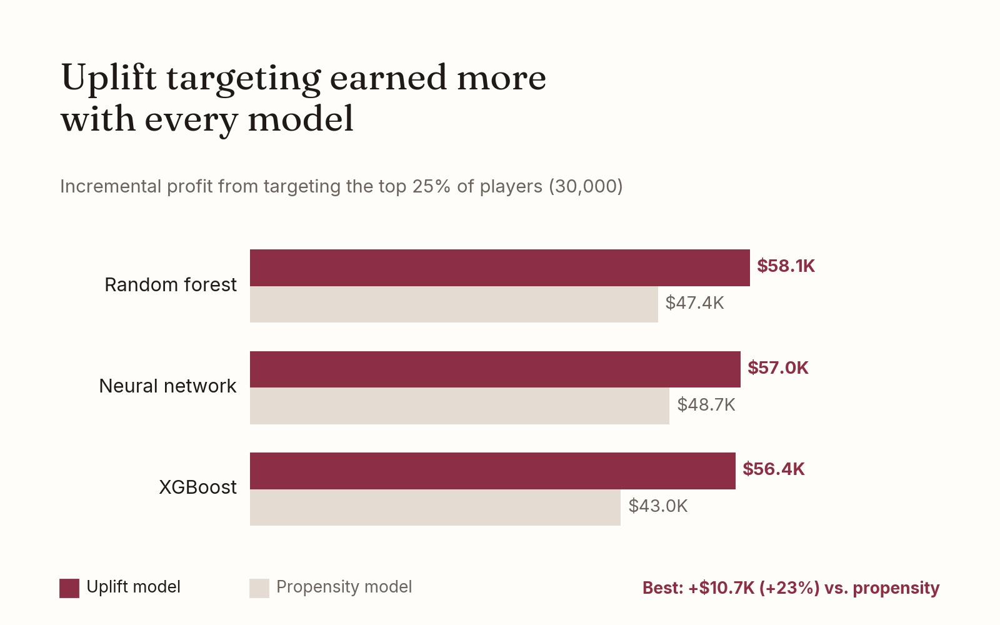

# Creative Gaming Uplift Modeling

Finding the players an in-app ad actually persuades to buy, instead of the ones who would buy anyway, to get the most profit from an ad campaign.

## The problem
Creative Gaming's mobile game Space Pirates launched a $14.99 in-app campaign and adoption was slow. An in-app ad raised conversion from 6% to 13% in a randomized test. The question: who buys *because of* the ad?

## Approach
- **Propensity models** predict who is likely to buy if shown the ad.
- **Uplift models** predict the *change* in buying caused by the ad: P(buy | ad) − P(buy | no ad), using separate models for players who saw the ad and those who didn't.
- Built both approaches with logistic regression, neural network, random forest and XGBoost, tuned with cross-validated grid search.
- Compared incremental profit from targeting 30,000 of 120,000 players (top 25%): extra buyers × $14.99 − $1.50 per player targeted.

## Results
| Algorithm | Uplift model | Propensity model | Uplift advantage |
|---|---|---|---|
| Random forest | $58,066 | $47,382 | +$10,684 |
| Neural network | $56,997 | $48,719 | +$8,277 |
| XGBoost | $56,373 | $43,046 | +$13,327 |
| Logistic regression | $45,908 | – | – |

By targeting the 25% of players most persuaded by the ad, the uplift model earns $58K in incremental profit, 23% more than propensity targeting and about $70K better than random targeting, which loses money. Roughly the bottom 10% of players were *less* likely to buy after seeing the ad, and uplift modeling lets the campaign skip them.

## Files
- `creative-gaming-uplift.ipynb` – full analysis

## Tools
Python, Polars, pyrsm, scikit-learn, XGBoost, plotnine

**Team:** Namratha K, Aanya Sikka, Yug Gadhiya · Customer Analytics, UC San Diego

*The course dataset and case materials are not included.*
